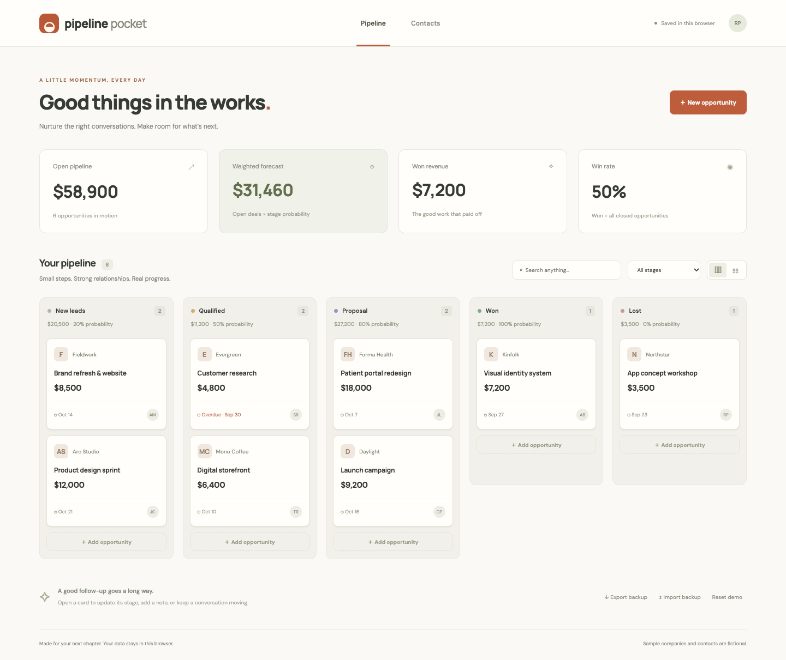

# Pipeline Pocket

[Open live app](https://mohdriyaazpersonal.github.io/pipeline-pocket/)



A lightweight CRM for independent teams: keep opportunities, contacts, conversation notes, and a weighted sales forecast in one responsive workspace.

## Run

Node.js 22 or newer. No package installation required.

```sh
npm start
npm test
npm run build
```

Visit the development server URL printed in your terminal. Deploy `dist/` to any static host. Serve over HTTP because the app uses JavaScript modules.

## Features

- Create, edit, and delete opportunities with company, value, contact, email, phone, notes, and expected close date.
- Five-stage board, accessible list view, and contact cards. Change stages in the opportunity editor.
- Search across opportunity details and notes; combine with stage filters.
- Open pipeline, probability-weighted forecast, won revenue, and closed-deal win rate.
- Persistent localStorage, validated JSON backup import/export, and confirmed destructive actions.
- Clearly fictional demo companies using reserved `.example` email domains.

## Forecast model

New leads use 20%, qualified 50%, and proposals 80%. Forecast sums only open opportunities; won revenue is displayed separately. Win rate is won deal count divided by won plus lost deal count. Amounts use USD. Expected close dates are informational; overdue open deals are marked. Summary statistics cover the whole workspace, while the board, list, and contacts respond to filters.

## Limits and privacy

Data stays in localStorage in this browser, with a limit of 2,000 opportunities. Export regularly: clearing browser data removes the workspace. There is no server, authentication, team synchronization, email delivery, or contact enrichment. Contacts belong to individual deals, so the same person can appear on multiple cards. Imported files replace the workspace after confirmation. Currency input retains cents, while summary cards round to whole dollars. Optional Google Fonts requests fetch typography with system fallbacks.

## Inspiration

Built with Codex as an independent code implementation inspired by Handshake's [Set up a sales CRM](https://app.joinhandshake.com/learn/set-up-a-sales-crm-615b8fad). This repository does not claim completion of provider-specific mission steps or submission to Handshake.
